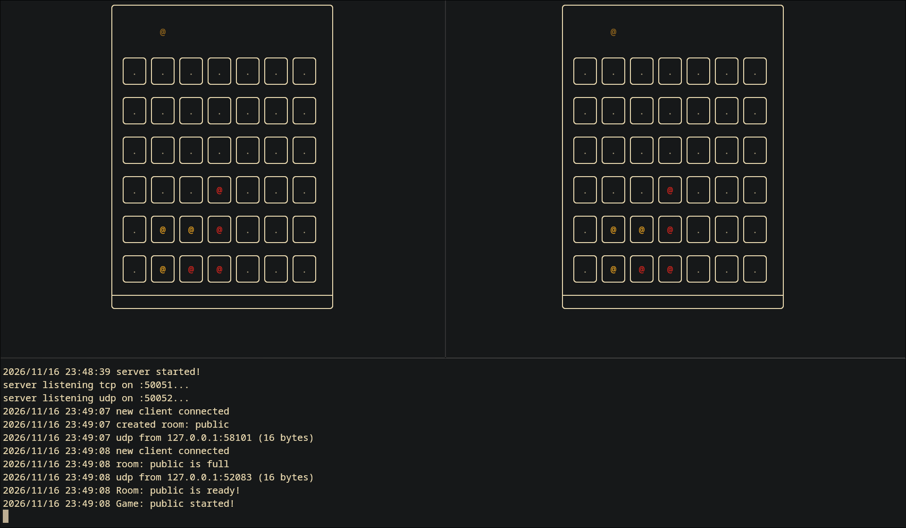

# p2pc4

Peer to Peer Connect Four in the terminal.
I made this p2p game for 2 main reasons. First because i have an idea for another bigger multiplayer game, but i wanted to start with something a bit easier. Secondly because of my distributed systems course in uni, i want to get comfortable with gRPC, since its what we use (even tho its quite a small part of the project now). 
The project is made using mostly cpp, and some go. This is also the first project ive made using CMake, and vcpkg

#### example image 


## How it works

1. Both players join the same room on the rendezvous server (gRPC)
2. The server tells each player the other's public address
3. The clients punch through NAT and play directly over UDP

The server is only used to find the other player

## tbd

<!-- TODO: keep this list up to date -->

- Linux only atm. Windows planned for the future
- maybe i will add offline ai opponent
- let clients start a server
- more gui screens for different outcomes  

## Build the client

Requirements: CMake 3.25+, Ninja, LLD, a C++20 compiler, and [vcpkg](https://vcpkg.io) with `VCPKG_ROOT` set. 

```sh
cmake --preset linux-release
cmake --build --preset linux-release
```

The binary is written to `bin/Release/connect4`. *(im planning to make releases of the game binary also)*

## Run the server

Requirements: Go.

```sh
go run ./src/server -tcp 50051 -udp 50052
```

Both ports must be reachable from the internet (TCP for gRPC, UDP for address discovery).

Server commands: 
- `list` shows all current rooms
- `clear` clears the screen (duh)
- `exit` closes the server

## Play
run the binary in a terminal
```sh
./bin/Release/connect4
```

Enter the server's IP, its two ports and a room name. The other player enters the same room name
The defaults for the server, and the client is localhost with tcp:50051, and  udp:50052

| Key | Action |
|---|---|
| Left / Right | Move your piece |
| Enter | Drop your piece |
| Esc | Leave / quit |

## Project layout

```
proto/        gRPC service definition
src/client/   C++ client (FTXUI, UDP networking)
src/server/   Go rendezvous server
scripts/      Go code generation
```


## Ai Disclosure
Following the [0rwx](https://0rwx.com/) framework for Ai usage, this project is AI:R. Meaning Ai has read my code, helped me come up with solutions, and been used for debugging. The reason for this is my limited knowledge on everything networking, learning new tools, my personal strive for optimal, professional, and clean code. Ive only had claude write some parts of this Readme. Everything else has been typed out by me, and also mostly from my brain  

